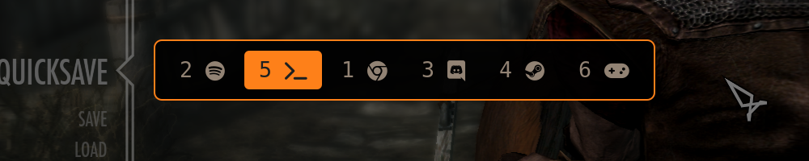

# sway-alttab

Windows-style **Alt+Tab for Sway workspaces**: hold Alt, tap Tab to walk back through the workspaces you used most recently, release Alt to stay. While you hold Alt, a strip of workspaces shows in the middle of the screen.



- **Most-recently-used order**: one quick Alt+Tab flips between your two latest workspaces; keep tapping Tab to go further back. Shift+Tab goes forward.
- **Release Alt to confirm**, just like on Windows. This is the part Sway can't do by itself (see [How it works](#how-it-works)).
- **On-screen strip** on the screen you started from, with the current pick highlighted. A very quick tap doesn't flash it.
- **No keyboard access for your apps**: Alt's release comes from a tiny, locked-down system service that reports nothing but "Alt down / Alt up".
- Also works on **i3** (everything except the strip).

## Install

Requirements: Sway (or i3), Python 3, and for the strip PyGObject + gtk-layer-shell:

```sh
sudo apt install python3-gi gir1.2-gtk-3.0 gir1.2-gtklayershell-0.1   # Debian/Ubuntu
```

Then:

```sh
./install.sh              # scripts to ~/.local/bin + the helper service (asks for sudo)
./install.sh --no-helper  # scripts only: Alt+Tab confirms after a 0.8s pause instead of on Alt release
```

Add the lines from [`config/sway.conf`](config/sway.conf) (or [`config/i3.conf`](config/i3.conf)) to your WM config and reload it.

To remove it, run `./uninstall.sh` and delete the config lines.

### Icons in the strip

The strip just shows each workspace's **name**, the same text your bar shows. With plain numbered workspaces you'll see numbers. It doesn't depend on any particular bar (swaybar, Waybar, i3bar all work).

To get app icons like in the screenshot, you need two things:

1. **The `workspace-icons` script** (uncomment its line in the config snippet). It renames workspaces to "N <icons of the apps on it>"; keybindings that use `workspace number N` keep working. Add your own apps to its `NICE` table (keys are the lowercase Wayland `app_id` / X11 class).
2. **[Symbols Nerd Font](https://www.nerdfonts.com/font-downloads)** installed, e.g. `NerdFontsSymbolsOnly` unzipped into `~/.local/share/fonts`, then `fc-cache -f`. The strip and your bar use it to draw the icons.

Skip this if you already name your workspaces some other way; the strip will show whatever names you use.

## How it works

| Part | Where it ends up | Role |
|---|---|---|
| `bin/workspace-history` | `~/.local/bin` | Background script: follows workspace focus over Sway/i3 IPC and keeps the MRU list. Alt+Tab / Alt+Shift+Tab send it `SIGUSR1` / `SIGUSR2`. |
| `bin/ws-switcher-overlay` | `~/.local/bin` | The strip: a GTK3 window on the gtk-layer-shell overlay layer. It never takes keyboard focus. Driven by JSON lines on stdin. |
| `helper/alt-release-watch` | `/usr/local/lib` | Reads the keyboards and sends one byte per Alt change (`D`/`U`) to `/run/alt-release/sock`. Every other key is ignored. |
| `helper/alt-release-watch.service` | `/etc/systemd/system` | Runs the helper as a throwaway `DynamicUser` whose only extra right is the `input` group: no network, no home, read-only system, input devices only. |
| `extras/workspace-icons` | `~/.local/bin` | Optional app icons in workspace names. |

**Why a helper?** Sway (and i3) only fire a `--release` binding for a key if no other key was pressed after it. With Alt+Tab you press Tab after Alt, so the compositor never reports Alt going up. There are two common workarounds:

- a timer ("pause to confirm"), which feels laggy, or
- adding your user to the `input` group, which lets **every** program you run read all your keystrokes.

sway-alttab uses a third option: a sandboxed system service that reads the keyboard itself and only ever tells your session when Alt goes up or down. Your user stays out of the `input` group, so Wayland's "apps only see keys sent to their own window" protection is kept. If the service isn't running, Alt+Tab falls back to the timer.

## Tweaking

- **Look**: edit the CSS at the top of `ws-switcher-overlay` (colors, font size, rounding, transparency). The default is Gruvbox Dark.
- **Delay before the strip shows**: `OVERLAY_DELAY` in `workspace-history` (default 0.12s).
- **Fallback timer**: `safety()` in `workspace-history` (0.8s without the helper).

## License

MIT
